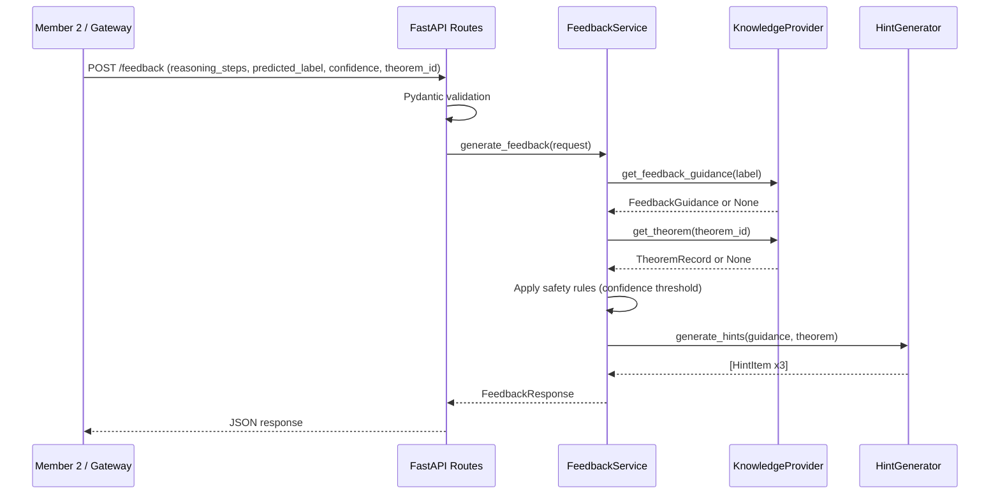
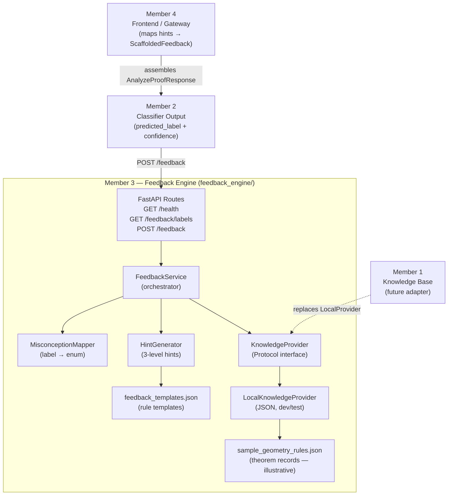

# Feedback and Explanation Engine
**SLIIT IT4010 Final-Year Research Project**  
**Member 3 — Kotinkaduwa K.M.D.L.B (IT23388802)**

---

## Component Overview

This component is the **Intelligent Feedback and Explanation Engine** for the project:

> *Intelligent Misconception Detection and Personalized Learning Support System for O/L Mathematics Students.*

It receives a predicted misconception label (produced by Member 2's classifier) and an optional geometry theorem identifier (from Member 1's knowledge base), then generates three levels of scaffolded hints to help a Sri Lankan GCE O/L Mathematics student correct their geometry-proof reasoning — without immediately revealing the final answer.

**What this component does:**
- Validates incoming requests with Pydantic models.
- Maps the predicted label to one of four supported misconception categories.
- Retrieves theorem data from a knowledge provider (local JSON in v1; Member 1's database in future).
- Applies rule-based templates to generate personalised feedback.
- Returns three progressively revealing scaffolded hints, a feedback summary, and an optional remedial study recommendation.

**What this component does NOT do:**
- It does not perform OCR or image processing (Member 2's responsibility).
- It does not store student proof submissions.
- It does not call any external LLM, cloud service, or paid API.
- It does not claim to produce validated educational content — the templates are illustrative and must be reviewed by a qualified educator before production use.

---

## Architecture

```
POST /feedback
      │
      ▼
 FastAPI Route (app/api/routes/feedback.py)
      │  validates with Pydantic (app/schemas/feedback.py)
      ▼
 FeedbackService (app/services/feedback_service.py)
      │  resolves label → MisconceptionMapper
      │  applies safety rules (confidence threshold)
      │  retrieves guidance ──────────────────────────────────────────────┐
      │  retrieves theorem  ──────────────────────────────────────────── KnowledgeProvider (Protocol)
      │                                                                    │
      │                                                            LocalKnowledgeProvider (JSON)
      │  delegates hint generation                              or Member1KnowledgeProvider (future)
      ▼
 HintGenerator (app/services/hint_generator.py)
      │  fills feedback_templates.json with theorem data
      ▼
 FeedbackResponse (returned to caller)
```

### Request Flow Diagram



### Component Diagram



---

## Prerequisites

- Python 3.11 or later
- pip
- Windows PowerShell, macOS Terminal, or Linux bash

---

## Installation

### 1. Navigate to the component directory

```powershell
cd Research-Project-\feedback_engine
```

### 2. Create and activate a virtual environment

**Windows (PowerShell):**
```powershell
python -m venv venv
.\venv\Scripts\Activate.ps1
```

**macOS / Linux:**
```bash
python3 -m venv venv
source venv/bin/activate
```

### 3. Install dependencies

```bash
pip install -r requirements.txt
```

### 4. Configure environment variables (optional)

```bash
cp .env.example .env
# Edit .env with your preferred values (all defaults work out of the box)
```

---

## Running the Application

```bash
# From feedback_engine/ with the virtual environment active:
uvicorn app.main:app --host 0.0.0.0 --port 8001 --reload
```

The API will be available at:

| URL | Purpose |
|---|---|
| `http://localhost:8001/health` | Health check |
| `http://localhost:8001/feedback/labels` | List supported labels |
| `http://localhost:8001/feedback` | POST — generate feedback |
| `http://localhost:8001/docs` | Interactive Swagger UI |
| `http://localhost:8001/redoc` | ReDoc API reference |

---

## Running the Automated Tests

```bash
# From feedback_engine/ with the virtual environment active:
pytest tests/ -v
```

Expected output: all tests pass.

To run a specific test file:
```bash
pytest tests/test_error_handling.py -v
```

To run with coverage (requires `pytest-cov`):
```bash
pip install pytest-cov
pytest tests/ -v --cov=app --cov-report=term-missing
```

---

## Example API Requests

### GET /health

```bash
curl http://localhost:8001/health
```

```json
{
  "status": "ok",
  "component": "feedback_engine",
  "version": "1.0.0",
  "knowledge_provider": "local_json"
}
```

### GET /feedback/labels

```bash
curl http://localhost:8001/feedback/labels
```

### POST /feedback — Incorrect Angle Relationships (SYNTHETIC example)

```bash
curl -X POST http://localhost:8001/feedback \
  -H "Content-Type: application/json" \
  -d '{
    "reasoning_steps": [
      "Angle ABC is 70 degrees",
      "Angle ADC is 70 degrees because they are opposite angles"
    ],
    "predicted_label": "Incorrect Angle Relationships",
    "confidence": 0.94,
    "theorem_id": "cyclic_opposite_angles",
    "question_id": "geometry_sample_01"
  }'
```

```json
{
  "status": "feedback_generated",
  "misconception_label": "Incorrect Angle Relationships",
  "theorem_reference": "cyclic_opposite_angles",
  "feedback_summary": "The angle relationship you used does not match the geometric configuration here. Review the correct relationship for this situation.",
  "hints": [
    {
      "level": 1,
      "title": "Think about the relationship",
      "message": "Are the angles in your diagram equal to each other, or do they add up to a specific value such as 90 or 180 degrees?"
    },
    {
      "level": 2,
      "title": "Recall the theorem",
      "message": "In this configuration, the relevant theorem is: 'The opposite angles of a cyclic quadrilateral sum to 180 degrees.'. What does that tell you about how these angles relate?"
    },
    {
      "level": 3,
      "title": "Apply the rule",
      "message": "Use the correct angle relationship from the theorem to recalculate. Start from the angle you know and apply the rule to find the unknown."
    }
  ],
  "reveal_final_answer": false,
  "requires_teacher_review": false,
  "remedial_guidance": {
    "topic": "Angle Relationships in Circles and Cyclic Quadrilaterals",
    "recommendation_note": "Practice distinguishing between equal angles (same segment theorem) and supplementary angles (opposite angles in a cyclic quadrilateral) using worked examples."
  },
  "confidence_acknowledged": 0.94
}
```

### POST /feedback — Low confidence (triggers cautious feedback)

```bash
curl -X POST http://localhost:8001/feedback \
  -H "Content-Type: application/json" \
  -d '{
    "reasoning_steps": ["Angle ABD equals angle ACD"],
    "predicted_label": "Incorrect Theorem Application",
    "confidence": 0.45
  }'
```

Response: `status: "cautious_feedback"`, `requires_teacher_review: true`.

---

## Integration Guide for Other Members

### For Member 2 (Classifier / OCR Pipeline)

**How to call Member 3:**

Send a `POST /feedback` request with:
- `reasoning_steps`: list of strings extracted by your OCR pipeline
- `predicted_label`: one of the four supported strings (see `GET /feedback/labels`)
- `confidence`: your classifier's confidence score in `[0.0, 1.0]`
- `theorem_id` *(optional)*: the theorem identifier most relevant to the question

**Pending decisions:**
- Confirm which service orchestrates the call to Member 3 (Member 2's service or a shared gateway).
- Confirm that `reasoning_steps` arrives as a pre-extracted list of strings, not raw OCR text.
- Share the final set of theorem IDs you expect to pass so the knowledge base can be verified.

### For Member 1 (Knowledge Base)

**How to replace the local provider:**

1. Create `app/repositories/member1_knowledge_provider.py`.
2. Implement a class that satisfies the `KnowledgeProvider` Protocol in `app/repositories/knowledge_provider.py`:
   - `get_theorem(theorem_id: str) -> TheoremRecord | None`
   - `get_feedback_guidance(label: str) -> FeedbackGuidance | None`
   - `provider_name: str` property
3. In `app/main.py`, add a branch for `KNOWLEDGE_PROVIDER=member1_api` to instantiate your class.
4. Set `KNOWLEDGE_PROVIDER=member1_api` and `MEMBER1_API_BASE_URL=<your endpoint>` in `.env`.

**Pending decisions:**
- Your API endpoint paths and authentication method.
- Your database schema field names (to map into `TheoremRecord`).
- Whether your service returns `FeedbackGuidance`-compatible template data or only raw theorem records (in which case feedback templates remain in Member 3's JSON).

### For Member 4 (Frontend / Gateway)

**Mapping Member 3's response to `AnalyzeProofResponse`:**

The frontend (`types/api.ts`) expects:
```typescript
feedback: {
  level_1_hint: string;       // ← hints[0].message
  level_2_hint: string;       // ← hints[1].message
  level_3_guiding_question: string; // ← hints[2].message
}
remedial_guidance?: {
  topic: string;
  recommendation_note: string;
}
```

The gateway that assembles `AnalyzeProofResponse` must perform this mapping after calling Member 3.

**Pending decisions:**
- Which port Member 3 runs on in the integrated deployment (default: `8001`).
- Whether the gateway calls Member 3 synchronously or asynchronously.
- CORS origins to allow in production.

---

## Security and Privacy Considerations

- Student reasoning steps are **not stored** to disk or database by this component.
- Reasoning step content is **not logged** (only label, confidence, and question_id are logged at INFO level; question_id is treated as opaque).
- No student-identifying information is accepted or processed by this API.
- No external HTTP calls are made by this service (fully offline in v1).
- The `reveal_final_answer` field is always `false` — the engine never provides the complete solution to a student.
- Teacher review is flagged for low-confidence predictions (threshold configurable via `LOW_CONFIDENCE_THRESHOLD`).

---

## Current Limitations

| Limitation | Notes |
|---|---|
| Theorem data is illustrative | `sample_geometry_rules.json` has not been verified against the NIE syllabus |
| Feedback templates are illustrative | Not reviewed by a qualified O/L Mathematics educator |
| English only | `language` field accepted but only English templates exist in v1 |
| No confidence calibration | Classifier confidence is taken at face value; no recalibration |
| Local JSON provider only | Member 1's knowledge base adapter is not yet implemented |
| No authentication | Service is open; add auth in the gateway layer before production |
| No OCR gap detection | "Missing Proof Step" does not distinguish OCR failure from genuine gaps |

---

## Features Implemented vs Pending

### ✅ Implemented (v1)

- `GET /health` — health check endpoint
- `GET /feedback/labels` — list four supported labels with descriptions
- `POST /feedback` — full scaffolded feedback generation for all four labels
- Pydantic request/response validation
- Rule-based 3-level hint generation with template substitution
- Fallback hints when theorem is not found (no invented content)
- Low-confidence safety path with teacher-review flag
- Missing confidence value handled safely (not fabricated)
- Local JSON knowledge provider for offline development
- KnowledgeProvider Protocol interface for future Member 1 adapter
- Structured logging (no student data in logs)
- Dependency injection via FastAPI app state
- CORS headers for Member 4's Next.js frontend
- Automated test suite (14 test IDs covered)
- Interactive API documentation (`/docs`, `/redoc`)
- Environment-variable configuration (`.env.example`)

### ⏳ Pending / Future Work

- Member 1 knowledge base adapter (`Member1KnowledgeProvider`)
- Sinhala/Tamil language templates
- OCR confidence integration (distinguish OCR gap from reasoning gap)
- Classifier confidence recalibration
- Authentication / API key middleware (to be added at gateway layer)
- Extended theorem coverage beyond six sample records
- Educator review of all feedback templates and theorem statements

---

## Academic Disclaimer

The theorem records in `app/data/sample_geometry_rules.json` and the feedback templates in `app/templates/feedback_templates.json` are **illustrative samples** created for prototype development.  They have not been:
- Verified against the official NIE Grade 10/11 Mathematics syllabus.
- Reviewed by a qualified GCE O/L Mathematics educator.
- Approved by any examiner or curriculum authority.

Do not present these as authoritative curriculum content in academic writing or public deployment.
